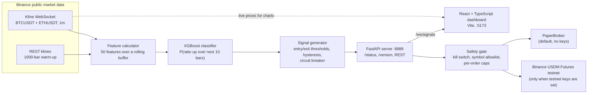

# Predicting Relative Movement Between Cryptocurrency Pairs

Curated public snapshot of my private development repository (2025–26).

Final-year project, Maynooth University (graded First). This repository includes work extended after submission.

The project predicts whether the BTC/ETH price ratio will rise or fall over the next ten minutes, serves that prediction live, and can trade it. The ratio rises when Bitcoin outperforms Ether and falls when Ether outperforms Bitcoin, so a prediction about the ratio is a prediction about relative movement, whichever way the wider market goes.

## What it does

- An XGBoost classifier predicts whether the BTC/ETH price ratio rises over the next 10 one-minute bars.
- 50 engineered features and walk-forward cross-validation.
- Compared with feed-forward neural networks.
- A FastAPI model server streams live predictions over WebSockets to a React and TypeScript dashboard.
- Order execution on the Binance USDM Futures testnet, with a paper-trading fallback (no keys needed).

## Architecture



A ratio position has two legs. Going long the ratio buys BTCUSDT and sells ETHUSDT; going short does the opposite. The broker client only connects to `testnet.binancefuture.com` (`api/broker_client.py:49`), and any `BINANCE_ENV` value other than `demo` falls back to the simulated `PaperBroker`.

## Stack

| Layer | Tools |
|---|---|
| Model and data | Python, XGBoost, pandas, NumPy, scikit-learn, PyArrow |
| Server | FastAPI, Uvicorn, WebSockets, Pydantic, python-jose (JWT, optional auth), bcrypt |
| Dashboard | React 19, TypeScript 5.9, Vite 7, Tailwind CSS 4, Lightweight Charts, ExcelJS |
| Execution | Binance USDM Futures testnet REST, simulated paper broker |
| Tests | pytest, Vitest |

## Run it locally (paper mode)

You need Python 3.12, Node.js 22 and network access to `api.binance.com` and `stream.binance.com`. No API keys are needed.

1. Clone the repository and install the Python dependencies:

   ```bash
   git clone https://github.com/Sai-prabha/predicting-relative-movement.git
   cd predicting-relative-movement
   python3.12 -m venv .venv
   source .venv/bin/activate
   pip install -r requirements.txt
   ```

2. Start the model server. It loads the trained model from `models/v4_14_production/`, pulls 1000 one-minute candles for each coin to warm up the features, then follows the live kline stream:

   ```bash
   python start_model_server.py
   ```

   Check it at http://localhost:8888/status. `data_quality.ready` turns `true` once the warm-up has loaded, and `broker.mode` reads `paper`.

3. In a second terminal, start the dashboard and open http://localhost:5173:

   ```bash
   cd FrontEnd
   npm ci
   npm run dev
   ```

The server defaults to strategy version v4.15. `python start_model_server.py --model-version v4.18` runs another version with the same model weights (choices: v4.15, v4.16, v4.17, v4.18).

### Optional: Binance Futures testnet

Copy `binance-env.sh.example` to `binance-env.sh`, which git ignores, and fill in testnet keys from https://testnet.binancefuture.com. Then run `source binance-env.sh && python start_model_server.py`. The file also lists the safety settings: dry-run mode, per-order quantity caps and the symbol allowlist. Creating `data/live/KILL_SWITCH` blocks all orders without a restart.

## Run the tests

```bash
python -m pytest                      # backend suite
python tests/test_broker_safety.py    # self-check: safety gate, host pin, paper fallback
python tests/test_auto_exec_e2e.py    # self-check: signal-to-order path on the paper broker

cd FrontEnd
npm test                              # Vitest
npm run build                         # type-check and production build
```

On a fresh clone the backend suite runs 203 tests and the dashboard runs 6, and all of them pass. The tests need no API keys.

## Project structure

```
api/                       FastAPI model server and everything it imports
  model_server.py          app, Binance feed, signal loop, REST + /ws/signals, broker endpoints
  feature_calculator.py    the 50 live features and the signal generators
  version_config.py        strategy versions v4.15 to v4.18
  broker_client.py         testnet broker, paper broker, order safety gate
  execution_guards.py      pre-trade guards (stale data, exposure caps)
  kill_switch.py           session max-loss switch
  execution_control.py     single-writer auto-execute control with audit trail
  reconciliation.py        broker fill ingest and PnL attribution
  microstructure_*.py      order-book and trade-tape capture (off by default locally)
  strategy_lab.py, simulation_lab.py, timing_advisor.py, ops_audit.py
                           strategy research tooling added after submission
FrontEnd/                  React + TypeScript dashboard (Vite)
models/v4_14_production/   trained XGBoost weights, feature list, training config
scripts/fast_backtest.py   fee-aware backtest over cached model probabilities
scripts/train_v4183.py     later retraining experiment (used by one test)
tests/                     pytest suite and two self-check scripts
docs/                      design records: execution control, reconciliation, microstructure
reports/eval/holdout2026/  the hold-out evaluation cited under Results
start_model_server.py      server entry point
```

## Results

### Classification

The shipped model's training run recorded these figures in `models/v4_14_production/config.json`. They come from a chronological hold-out, the last 34,767 bars of the training data, which was also used for early stopping. So they are not walk-forward results, and they lean slightly optimistic.

| Metric | Value | Source |
|---|---|---|
| Prediction horizon | 10 one-minute bars | `config.json:10` |
| Features | 50 | `config.json:12` |
| Training data | 348,456 one-minute bars, 2025-02-06 to 2025-10-06 | `config.json:5`, `config.json:7-8` |
| Hold-out size | 34,767 bars | `config.json:37` |
| Hold-out ROC AUC | 0.538 (chance is 0.5) | `config.json:35` |
| Hold-out hit rate | 52.9% | `config.json:36` |

The walk-forward cross-validation and the comparison with feed-forward networks are in the dissertation. That code and those results are not in this repository.

### Trading costs

The signal's edge did not survive taker fees. In July 2026, after submission, `scripts/fast_backtest.py` replayed the default strategy (v4.15) over a later hold-out window, 15 December 2025 to 1 July 2026, charging Binance USDM taker fees of 0.045% per fill. A ratio round trip is four fills (two legs, each opened and closed), so each trade costs 0.18%. Over 3,329 trades the average trade made +0.035% before fees and lost 0.145% after them.

| Figure | Value | Source |
|---|---|---|
| Taker fee per fill | 0.045% (4.5 bps) | `scripts/fast_backtest.py:17`, `reports/eval/holdout2026/scorecard.json:7` |
| Fills per ratio round trip | 4 | `scripts/fast_backtest.py:18`, `scorecard.json:8` |
| Round-trip cost | 0.18% | `api/version_config.py:301` |
| Window | 2025-12-15 to 2026-07-01 | `scorecard.json:4-5` |
| Trades | 3,329 | `scorecard.json:13` |
| Average trade before fees | +0.035% | `scorecard.json:15` |
| Average trade after fees | -0.145% | `scorecard.json:48` |

## Design decisions

*Draft notes, to be written up in my own words.*

**Why predict 10 one-minute bars ahead?**
- The label is the sign of the ratio's move over the next 10 bars (`k_ahead: 10`, `config.json:10`).
- The live path recomputes the features on each new 1m candle and publishes a fresh P(up) each minute.
- Later, fee-aware work found the v4.15 to v4.17 entries earned about +0.01% to +0.03% per trade, roughly ten times below the 0.18% round-trip cost. v4.18 trades only the probability tails and holds for up to 240 bars instead (`api/version_config.py:299-315`, `:365`).
- Question for me: what drove the original choice of 10 bars (signal half-life, label noise, trade frequency)?

**Why walk-forward validation?**
- The data is a time series. Shuffled folds would train on bars that come after the bars being tested.
- Every feature is a causal rolling window with a minimum period, max lookback 780 bars, so live values match the values computed over the full history (`scripts/fast_backtest.py:11-15`).
- The later evaluations keep the same rule: tune on one window (Oct to Dec 2025), then check once on a later window (Dec 2025 to Jul 2026). See `scripts/fast_backtest.py:23-26`.
- Question for me: fold layout and step size used in the dissertation.

**Why these features?**
- 50 selected by importance from a larger engineered set (`config.json`: `max_features: 50`).
- Groups: 13 ratio rolling statistics, 10 trend, 8 buy/sell pressure from taker volume, 6 volatility regime and spread, 5 BTC-ETH correlation, 5 calendar and session, plus RSI, a lagged return and a return z-score. Names are in `models/v4_14_production/feature_names.json`.
- Buy/sell pressure uses the taker-buy volume field in each Binance kline (`api/feature_calculator.py:97-106`).
- Z-scores are clipped at 5 sigma. Rolling windows are 5, 10 and 30 bars short, and 60 and 120 long (`api/feature_calculator.py`, constants at the top).
- The live calculator reproduces the training feature code so the model sees the same inputs live as in training. `scripts/fast_backtest.py --parity N` checks this.
- Question for me: which feature families mattered most, and why the ratio rather than each coin separately?

**Why a testnet, with a paper fallback?**
- USDM futures let each leg be shorted, which a two-leg ratio position needs (short ratio = sell BTCUSDT + buy ETHUSDT, `tests/test_auto_exec_e2e.py`).
- The testnet runs the real order path with no money at risk. The client refuses any other host (`api/broker_client.py:49`).
- Without testnet keys (`BINANCE_ENV` not `demo`) the server uses `PaperBroker`, so the full signal-to-order path runs for anyone, and in the tests (`tests/test_broker_safety.py`).
- Further rails: kill-switch file, dry-run mode, per-order caps, symbol allowlist (`binance-env.sh.example`).
- Question for me: anything about the assessment setting that ruled out real funds?

## Project timeline

- February 2026, before submission: the v4.15 backend (model server, live features, signal generator) and the React dashboard, set up for deployment.
- June 2026: repository consolidation, utility scripts and the testnet configuration template.
- 10 to 13 July 2026: execution safety rails, a shadow mode that runs a candidate strategy alongside the live one, persisted broker execution history, a data-freshness contract, guarded model promotion, a broker-aware order planner with balance-based sizing, and a strategy research lab with walk-forward ranking.
- 14 to 15 July 2026: a single-writer execution control plane, trade reconciliation against broker fills, operator tools, net-of-cost evaluation of later strategy versions, and an order-book and trade-tape capture layer. The design records are in `docs/`.

## What is not included

- The training pipeline and the training data. The model ships already trained, but this repository cannot retrain it.
- The feed-forward network experiments.
- Research logs and the full cost studies.

## Licence

MIT. See [LICENSE](LICENSE).
